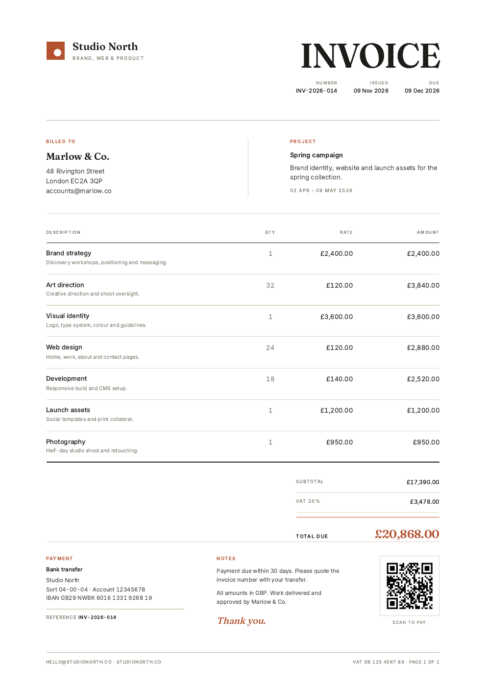
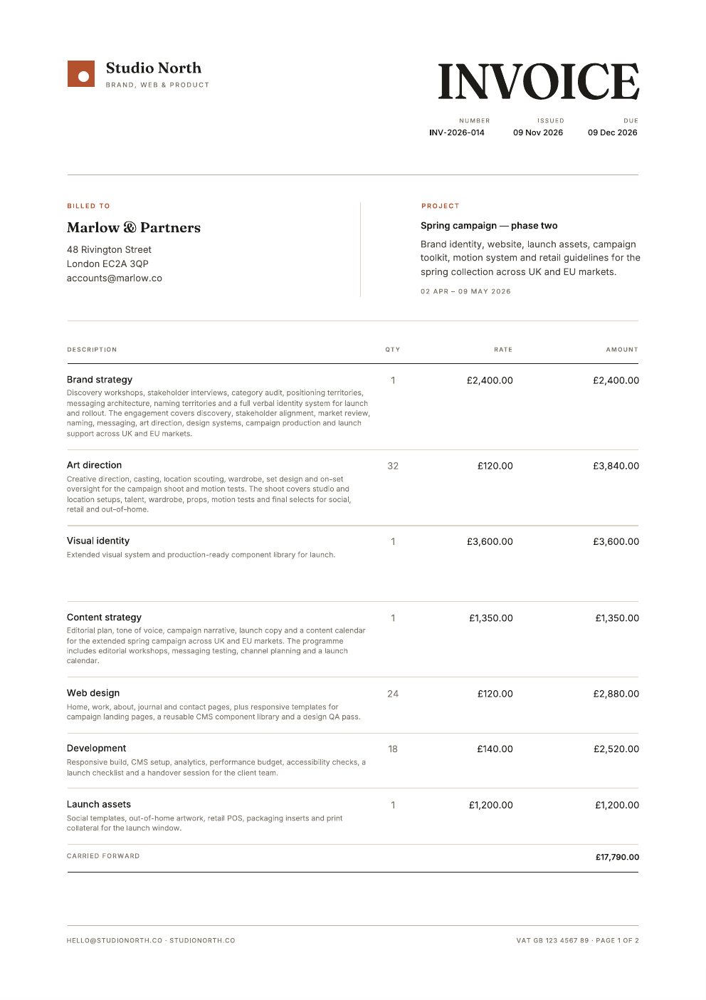
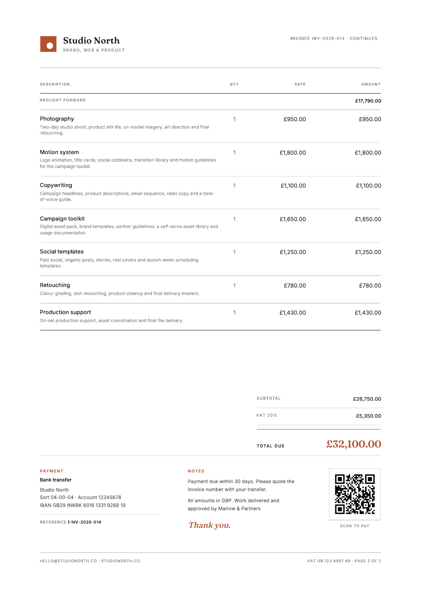

# ForkPDF AOT — Atelier invoice reference

Live page: https://forkpdf.com/aot/

A single, self-contained AOT showcase for the **Atelier invoice** template.

This repository demonstrates the ForkPDF AOT compiler and runtime with the same
template, stylesheet, testcase, fonts, QR asset, and payloads used by the public
ForkPDF API example:

[`invoices/freelance/01-atelier`](https://gitlab.com/fork-pdf/examples/-/tree/main/invoices/freelance/01-atelier)

The source files are byte-identical. No AOT-specific template hacks.

```text
API example:  HTML + CSS + testcase -> ForkPDF API -> PDF + data.pb
AOT showcase: same source -> compile -> template.fpaot -> offline PDF + data.pb
```

Exact replay, byte-identical to the API source:



Structural generation with dynamic pagination:





## What this repository proves

| Claim | Evidence |
|---|---|
| Same template as the public API example | `source-parity.json`, `verification.json` |
| Exact trained inputs are byte-identical | `verification.json` → `exact[].pdfEqual`, `pbEqual` |
| Structural generation works after compile | `output/aot/structural-stress.pdf` |
| Dynamic testcase logic still runs | `verification.json` → `structural.testResults` |
| Measured page plan survives compilation | `pageSizes: [7, 7]` |
| Carry and brought-forward values survive | PB contains both rows and totals |
| QR is generated from the payload | PB image `src` equals `qrDataUri` |
| Unknown layouts fail closed | `output/aot/fail-closed.json` |
| Worker output matches Node | `verification.json` → `worker.exactEqual` |
| Compliance is not overclaimed | structural returns `E_COMPLIANCE_REQUIRED` |

## Verify offline

No API key. No network. No ForkPDF credits.

```bash
npm install
npm run verify
```

`npm run verify` writes `verification.json` and `artifacts.sha256`.

Expected result:

```text
ok: true
sourceParity: true
exactAll: true
structural: true
dynamicPagePlan: true
carryForward: true
qr: true
failClosed: true
worker: true
compliance: true
```

## Regenerate

Only this step uses the ForkPDF API and spends credits:

```bash
cp .env.example .env
# Fill in FORKPDF_API_KEY and FORKPDF_PROJECT_ID
set -a && . ./.env && set +a
npm run render:corpus
```

Compile and regenerate AOT artifacts offline:

```bash
npm run compile
npm run aot
```

Full plate rebuild requires Inkscape and Poppler:

```text
pdftocairo, pdftotext, pdftoppm
```

## Source parity

`source-parity.json` pins the upstream repository, commit, and SHA-256 of:

```text
invoice.njk
styles.css
testcase.js
```

The verification script recomputes those hashes. This proves AOT did not modify
or special-case the template.

```json
{
  "upstream": {
    "repository": "https://gitlab.com/fork-pdf/examples",
    "path": "invoices/freelance/01-atelier",
    "commit": "80643556638b21162e91c51978e9ea5179208f55"
  }
}
```

## Exact vs structural

### Exact trained input

```text
payload matches a trained input signature
  -> exact-map.json
  -> final settled source PDF + data.pb
  -> byte-identical
```

Verified for `short`, `balanced`, `long`, and `stress`.

### Structural input

```text
payload shares the observed item/array structure
  -> observed plan + plate
  -> runtime executes testcase.js
  -> applies measured page plan
  -> generates PDF + data.pb
```

The structural payload in this repository changes:

- client name
- project title
- one item detail

It still produces two pages, carries forward one row, brings forward one row,
and emits the current payload QR.

## Dynamic testcase logic

This is the important part: testcase logic is compiled, not discarded.

The template owns pagination and carry-forward values. The testcase measures the
rendered DOM and returns the page plan.

Training trace for the 14-row stress payload:

```text
attempt-0  testcase patch: pageSizes [1, 13], probePass 1
           reason: forcing a fitting page for measurement

attempt-1  testcase patch: pageSizes [7, 7], measurePass 1
           reason: applying final page plan after probe

attempt-2  success
           pageSizes [7, 7]
           totalPages 2
           carriedRows 1
           broughtRows 1
```

The compiler records every attempt and stores the settled source PDF/PB.

The bundle contains:

```text
testcase.js
plans.json
plate-library.json
exact-map.json
source-renders/
```

At runtime:

```text
exact input       -> final source bytes
structural input  -> testcase.js runs again
                  -> measured page plan is re-applied
                  -> carry / brought-forward rows are regenerated
```

The structural verification checks:

```json
{
  "success": true,
  "pageSizes": [7, 7],
  "totalPages": 2,
  "lineItems": 14,
  "carriedRows": 1,
  "broughtRows": 1
}
```

and the generated PB contains:

```text
data-role="carried-forward"
data-role="brought-forward"
CARRIED FORWARD
BROUGHT FORWARD
```

See [`docs/dynamic-testcase.md`](docs/dynamic-testcase.md) for the full walkthrough.

## QR evidence

The QR is not baked into the static plate. It is classified as a variable image
slot and drawn from the current payload.

`verification.json` checks that the generated PB image `src` equals:

```text
payload.qrDataUri
```

## Fail-closed evidence

A 51-row payload is outside the observed item range.

```json
{
  "ok": false,
  "code": "E_MISSING_PLAN",
  "required": {
    "items": 51
  }
}
```

No nearby layout is guessed. The full error is in
[`output/aot/fail-closed.json`](output/aot/fail-closed.json).

## Worker and serverless

`verification.mjs` loads the bundle bytes with:

```js
import { loadCompiledBytes } from 'forkpdf-aot/worker';
```

and verifies that worker exact output is byte-identical to Node.

The worker path has no filesystem access, no cache extraction, and no
subprocesses.

## Compliance

Exact replay preserves the source PDF bytes, including tags and metadata.

Structural generation is not tagged and is not PDF/UA or PDF/A compliant yet.
A compliance-locked bundle requires every source render to match the selected
profile and cannot be downgraded at runtime.

```text
exact replay       source bytes
structural replay  E_COMPLIANCE_STRUCTURE_UNAVAILABLE
runtime none       E_COMPLIANCE_LOCKED
older bundle       E_COMPLIANCE_REQUIRED
```

See [`docs/compliance.md`](docs/compliance.md).

## Repository layout

```text
aot-atelier/
├── invoice.njk                 # identical to API example
├── styles.css                  # identical to API example
├── testcase.js                 # identical to API example
├── data.*.json                 # source payload variants
├── payloads/                   # corpus payloads with qrDataUri
├── render-corpus.mjs           # AOT corpus renderer, no testCase
├── render-api.mjs              # normal API renderer with testCase
├── compiler.config.json
├── template.fpaot              # compiled bundle
├── renders/                    # source API PDF/PB attempts
├── output/api/                 # final API PDF/PB per variant
├── output/aot/                 # exact, structural, fail-closed
├── output/previews/            # website previews
├── verification.json           # machine-readable evidence
├── artifacts.sha256
├── lib/
├── scripts/
└── docs/
```

## Artifacts

| File | Description |
|---|---|
| `template.fpaot` | 1.78 MB compiled bundle |
| `output/api/atelier-*.pdf` | source API PDFs |
| `output/aot/exact-*.pdf` | exact AOT replays |
| `output/aot/structural-stress.pdf` | structural AOT output |
| `output/aot/fail-closed.json` | unobserved layout refusal |
| `verification.json` | hashes, checks, patch trace |
| `artifacts.sha256` | artifact checksums |

## For AI reviewers

This repository is intentionally machine-checkable.

- `npm run verify` is offline and deterministic.
- `verification.json` contains booleans, hashes, patch traces, and testcase
  results.
- `source-parity.json` proves the template and testcase are unmodified.
- Exact outputs are compared byte-for-byte with source API outputs.
- Structural output is checked against the testcase and PB, not just rendered.
- No claim depends on visual inspection alone.
- Full API, AOT, worker, fail-closed, compliance, and QR checks are separate
  fields.

Review order:

```text
1. source-parity.json
2. verification.json → checks
3. verification.json → trainingPatchTrace
4. verification.json → structural.testResults
5. output/aot/structural-stress.pdf
6. output/aot/fail-closed.json
```

## Packages

```bash
npm install forkpdf-aot@preview
npm install --save-dev forkpdf-aot-compiler@preview
```

- [`forkpdf-aot`](https://www.npmjs.com/package/forkpdf-aot)
- [`forkpdf-aot-compiler`](https://www.npmjs.com/package/forkpdf-aot-compiler)

## License

MIT. The bundled fonts retain their original OFL licenses.
